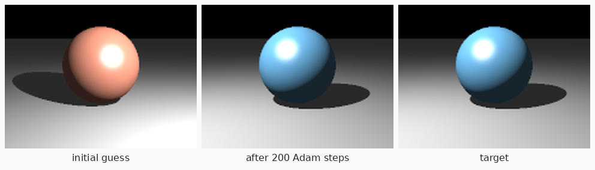

# Horizon.jl

[](https://github.com/pixelsandpointers/Horizon.jl/actions/workflows/CI.yml)

A small differentiable renderer in pure Julia.

Horizon is a direct-illumination ray tracer with:

- **Geometry:** spheres and infinite planes.
- **Lights:** point lights and directional lights, with hard shadows.
- **Material:** a Lambertian + energy-normalized Blinn-Phong BRDF.

Every type is parametric over its number type. You can push the whole renderer through ForwardDiff.jl, Zygote.jl, Enzyme.jl, or any other AD tool that works on ordinary Julia code. Horizon itself only depends on `LinearAlgebra`.



*Recovering a sphere's albedo and a point light's position from one target image (`examples/inverse_rendering.jl`).*

## Installation

```julia
pkg> add https://github.com/pixelsandpointers/Horizon.jl
```

## Quick start

```julia
using Horizon

scene = Scene(
    (Sphere(Vec3(0, 0.5, 0), 1, Material(albedo = Vec3(0.8, 0.3, 0.2), specular = 0.3, shininess = 40)),
     Plane(Vec3(0, -0.5, 0), Vec3(0, 1, 0), Material(albedo = 0.6))),
    (PointLight(Vec3(3, 4, 4), 120),);
    ambient = 0.03,
)
camera = PinholeCamera(Vec3(0, 1.2, 6), Vec3(0, 0.2, 0); width = 320, height = 240, fov = 35)

img = render(scene, camera; supersample = 2)   # Matrix{Vec3{Float64}}, linear radiance
save_ppm("hello.ppm", img)
```

## Differentiating

Write the scene as a function of your parameters and differentiate a loss through `render`:

```julia
using ForwardDiff, Zygote

build(p) = Scene((Sphere(Vec3(0, 0, 0), 1, Material(albedo = Vec3(p[1], p[2], p[3]))),),
                 (PointLight(Vec3(p[4], p[5], p[6]), 50),))

target = render(build([0.2, 0.6, 0.7, -2.0, 4.0, 3.0]), camera)
loss(p) = mse(render(build(p), camera), target)

p = [0.7, 0.4, 0.3, 2.0, 3.0, 4.0]
ForwardDiff.gradient(loss, p)        # forward mode: best for a handful of parameters
Zygote.gradient(loss, p)[1]          # reverse mode: same result, scales to many parameters
```

The test suite checks that forward- and reverse-mode gradients agree, and that both match central finite differences.

### Practical notes

- **Use tuples for shapes and lights.** Passing `(s1, s2)` rather than `[s1, s2]` keeps heterogeneous scenes type-stable. Vectors are accepted and converted.
- **Number types propagate.** The image's number type is the promotion of every number in the scene and camera. A `Dual`, `Float32`, or any other `Real` flows through automatically. Default arguments are `Float64` (`albedo = 0.8`), so pass `Float32` values explicitly if you want a `Float32` render.
- **Supersampling is deterministic.** `supersample = n` samples each pixel on a fixed `n × n` grid. The image is therefore a noise-free function of the parameters, with no Monte Carlo variance in the gradients.

## Limitations

Horizon is deliberately simple. It is a sandbox for inverse-rendering ideas, not a production renderer.

- **No gradients from visibility discontinuities.** Silhouettes and shadow edges are treated as constants. AD gives the interior (shading) derivative but no boundary terms: no edge sampling, reparameterization, or soft rasterization. Gradients with respect to geometry are therefore biased whenever a loss depends on object or shadow boundaries. This is the same caveat as naive AD through Mitsuba 3 without its reparameterization integrators.
- **Direct illumination only.** There are no indirect bounces, area lights, or soft shadows.
- **CPU only and unoptimized.** Zygote in particular is slow on per-pixel scalar code. For small parameter counts, ForwardDiff is much faster.

## API

| | |
|---|---|
| `Vec3(x, y, z)`, `Vec3(v)` | points, directions, RGB colors |
| `Material(; albedo, specular, shininess)` | Lambertian + normalized Blinn-Phong |
| `Sphere(center, radius, material)` | sphere |
| `Plane(point, normal, material)` | infinite plane |
| `PointLight(position, intensity)` | inverse-square point light |
| `DirectionalLight(direction, irradiance)` | distant light (`direction` = direction of travel) |
| `Scene(shapes, lights; ambient, background)` | scene container |
| `PinholeCamera(eye, target; up, fov, width, height)` | pinhole camera |
| `render(scene, camera; supersample, shadows)` | render a `height × width` `Matrix{Vec3}` |
| `radiance(scene, ray; shadows)` | radiance along a single ray |
| `mse(a, b)` | differentiable image loss |
| `to_array(img)` | `height × width × 3` array |
| `tonemap(c; exposure, gamma)`, `save_ppm(path, img)` | display / output |

## Running the example and tests

```sh
julia examples/inverse_rendering.jl          # sets up its own environment on first run
julia --project -e 'using Pkg; Pkg.test()'
```

The package and the example both support Julia ≥ 1.10.

## License

MIT
